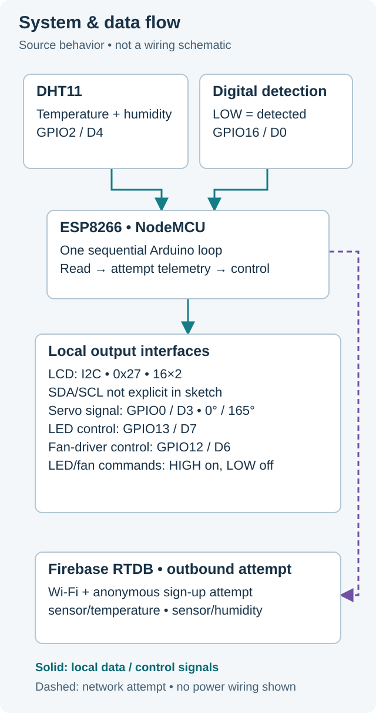

# ESP8266 Smart Home Prototype

An ESP8266 sketch that reads room temperature and humidity, displays them on a 16×2 LCD, and uses an active-low detection input to command a servo and temperature-dependent LED/fan control signals. It also attempts outbound Firebase telemetry.

Developed by Abdulla Salem.

**[Read the sketch](firmware/SmartHomePrototype/SmartHomePrototype.ino)** · **[Build with placeholders](docs/BUILD-NOTES.md)** · **[Control flow & timing](docs/CONTROL-FLOW.md)** · **[Limitations](docs/SECURITY-AND-LIMITATIONS.md)**

## What the code does

| Input / condition | Source behavior |
|---|---|
| DHT11 on GPIO2 / D4 | Reads integer temperature and humidity; refreshes LCD values at the end of the outer loop. |
| Detection on GPIO16 / D0 is **LOW** | Commands the servo to 0° each sampled pass; if `ct - pt > 1500`, also commands 165° and sets `pt = ct`. |
| LOW detection **and temperature > 25°C** | Sets LED GPIO13 / D7 and fan-driver GPIO12 / D6 HIGH. Blocks while temperature stays > 24°C, with a 1-second delay before each re-read. |
| Cooling read succeeds at **≤ 24°C**, or fails | Sets both outputs LOW, reports the actual exit reason, then waits 15 seconds. |
| Firebase ready + sign-up succeeded + timer due | Attempts integer writes to `sensor/temperature` and `sensor/humidity`. This happens before read-result validation. |

The servo signal is GPIO0 / D3. The LCD uses I2C address `0x27`; its SDA/SCL pins are not assigned explicitly in the sketch. These are **signal interfaces, not power wiring**. See the [system visual](docs/assets/system-flow.svg) and [exact timing visual](docs/CONTROL-FLOW.md).

## Implementation choices visible in the sketch

This is my small, single-sketch prototype: local display, detection-driven servo commands and a two-threshold cooling branch in one loop. The >25°C start and ≤24°C normal stop are different thresholds; the fan decision is only reached when detection is LOW. These are implemented constants, not calibrated environmental recommendations.

The main trade-off is visible in the control flow: while cooling, the sketch stops normal detection polling and outer telemetry updates. Servo timing is elapsed-time based, **not** a 1.5-second sustained-detection test. `pt` is not reset when detection begins, and the next sampled LOW pass commands 0° again. [Control flow & timing](docs/CONTROL-FLOW.md) makes those details explicit.

## Compile-only verification

The revised sketch compiled and linked on **23 October 2026** with Arduino CLI **1.4.1**, ESP8266 core **3.1.2** and target `esp8266:esp8266:nodemcuv2`, using placeholder configuration. [Build notes](docs/BUILD-NOTES.md) include exact dependency setup, the source hash, build result and Windows path caveat.

This verifies compilation, not working hardware or cloud integration. The prototype still has unbounded network/cooling waits, invalid-reading handling gaps and unverified actuator power/safe states. Do not use it for mains appliances or unattended loads. Details are collected in [security and limitations](docs/SECURITY-AND-LIMITATIONS.md).

## Project status

Personal prototype source, maintained here as a documented reference rather than a supported home-control product. No remote-control app, energy measurement or air-conditioner interface is implemented. This revision adds documentation/diagrams and narrowly corrects comments and an exit diagnostic; it does not redesign control behavior.

ESP8266 Arduino core, DHT11, LiquidCrystal I2C and the Firebase client are separate third-party dependencies, not bundled code. No license has been selected for this repository; publication alone does not grant reuse rights.
