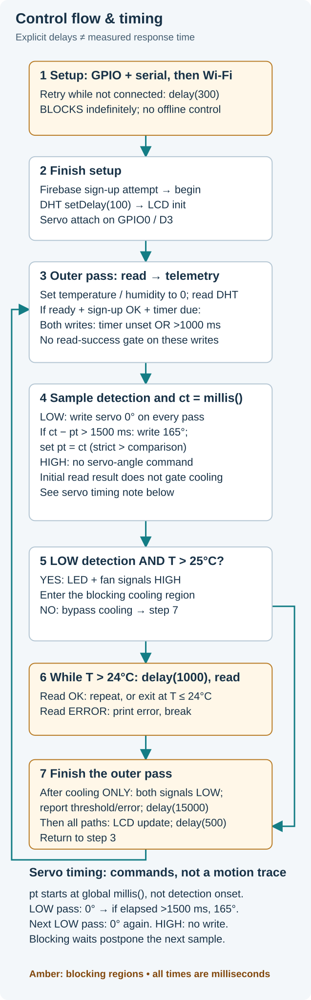

# Control flow & timing

[Overview](../README.md) · [Sketch](../firmware/SmartHomePrototype/SmartHomePrototype.ino) · [Build](BUILD-NOTES.md) · [Limitations](SECURITY-AND-LIMITATIONS.md)

## How to read the visual

The diagram describes source execution, not a measured timing trace. Network/library calls and sensor reads add unmeasured time to the explicit delays.

- **Setup:** configures GPIO/serial, then retries Wi-Fi forever with `delay(300)` before anonymous Firebase sign-up, Firebase initialization, DHT delay configuration, LCD initialization and servo attach. Local control does not start before setup completes.
- **Outer pass:** initializes temperature/humidity to zero, calls the DHT reader, then conditionally attempts both integer telemetry writes. The gate is `Firebase.ready() && signupOK && (millis() - sendDataPrevMillis > 1000 || sendDataPrevMillis == 0)`. It is not a fixed 1 Hz scheduler; the timestamp is set before the writes, and no read-success check gates them.
- **LOW detection:** samples `ct`, writes servo 0° unconditionally in this branch, then writes 165° only if `ct - pt > 1500`, storing `pt = ct`. The comparison is strict (>), not ≥. `pt` starts from a global `millis()` call and is not reset on detection onset. A later LOW pass writes 0° again; a HIGH pass writes no servo angle. No dwell time or smooth movement is prescribed by the code.
- **Cooling entry:** only LOW detection and `temperature > 25` set LED/fan signals HIGH. The initial read result does not guard this decision. With integer readings, 25 does not enter; 26 does.
- **Cooling block:** while `temperature > 24`, delay 1000 ms, re-read, and break on any nonzero result. A successful reading at 24 or below ends the loop normally. Both exits set the two signals LOW; only the serial exit reason differs in this revision. Then `delay(15000)` runs on either exit.
- **Tail:** HIGH detection prints its LCD/serial message without a servo write. Every pass then updates LCD humidity/temperature and calls `delay(500)` before starting over.

## Responsiveness boundary

During the cooling block there is no new outer-loop detection sample, LCD value refresh or outer telemetry attempt. Persistent heat can hold this block indefinitely. The following 15-second delay blocks those operations too. A non-cooling pass still includes the 500 ms tail delay and unmeasured sensor/network calls; no response-time bound has been established. The revision deliberately does not replace this architecture with a nonblocking controller.
